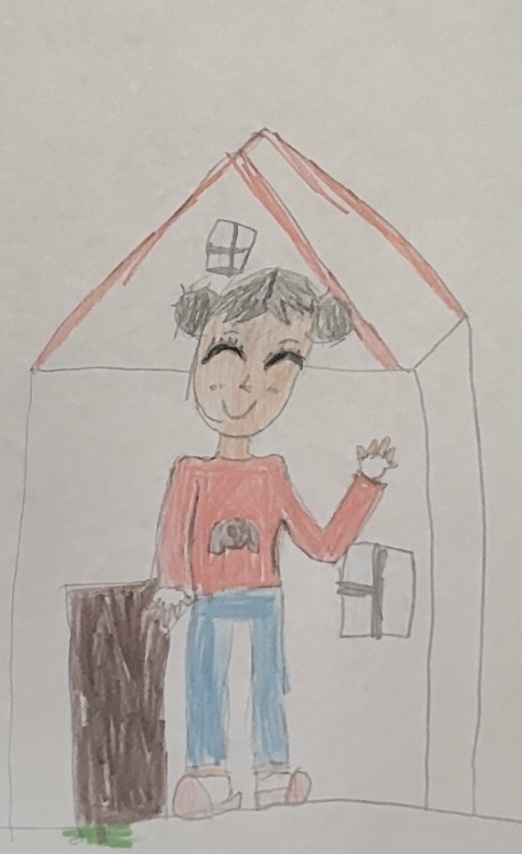

# CrayonMLX

A local web studio for transforming children's drawings on Apple Silicon.
Choose what to change: rendering style, characters, background, framing, and light.
Keep the child's original ideas and explicitly protect the details that matter.
Python + FastAPI, plain HTML/CSS/JavaScript, native MLX inference through MFLUX.

## Example: drawing → animated illustration

An actual local generation using **Qwen Image Edit 2509** through MFLUX.

| Original drawing | Generated illustration |
| :---: | :---: |
|  |  |

The prompt requests an animated-film appearance and replaces the background with a
South Korean mountain landscape. The red sweater, blue trousers, and waving gesture
remain recognizable; some details, including hair color, were reinterpreted by the model.

30 steps · guidance 2.5 · 768 × 1024 · seed `1811426623` · requested quantization: None.
See the [full prompt and parameters](assets/examples/character-redesign/generation.json).

**Early alpha.** Image quality, memory requirements, and checkpoint compatibility
depend on your model. Automated tests cover the UI backend and orchestration using
an injected renderer; they do not benchmark model inference.

## Install and run

Requires an Apple Silicon Mac, macOS compatible with MLX, and [uv](https://docs.astral.sh/uv/).
Install the published alpha:

```sh
uv tool install 'crayonmlx==0.1.0a1'
crayonmlx
```

Or install the current source from a checkout:

```sh
uv tool install .
crayonmlx
```

Open http://127.0.0.1:8787. Choose another port with `crayonmlx --port 8788`.
MFLUX libraries are installed with the app;
model weights are **not** bundled or downloaded at startup.

For development:

```sh
uv sync
uv run crayonmlx
uv run pytest
uv run ruff check .
uv build
```

## Workflow

1. In **Settings**, choose absolute paths for the model folder and output folder.
   Any accessible location, including an external disk, is supported.
2. Put each full Diffusers or MFLUX checkpoint in its own subfolder, or select a
   checkpoint folder itself. HF cache users can select a concrete snapshot directory.
   An individual `.safetensors` or `.gguf` file is not a complete checkpoint.
3. Alternatively download a repository and revision in **Models**. Private/gated
   repositories need a Hugging Face token in Settings and access granted on HF.
   Downloads run in the background. Incomplete downloads are hidden and can be resumed
   by requesting the same repository again. Download status is session-local.
4. Upload a drawing; start your own combination or select a saved full preset, then choose one local model. Its variant and MFLUX
   adapter are detected automatically. Unrecognized or ambiguous checkpoints are
   shown in Models with an explanation and cannot be used for generation.
5. Assemble independent blocks: **overall style**, **characters/objects**, **background**,
   **composition**, **lighting**, and **editing/preservation instructions**. Each block
   offers saved templates, “Do not change”, and editable text. Overall style does not
   dictate a new character or location. Subject-specific styling takes precedence
   for the original foreground subjects only.
6. Check what must remain: identity, clothing, poses, colors, subjects/objects,
   placement/scale, lettering/decorations, and original background. Choosing a new
   background unchecks background preservation; choosing a new composition unchecks
   placement preservation. The UI tells you when this happens. An unchecked option
   allows adaptation; it does not itself request a particular replacement.
7. Choose a generation configuration to apply its parameters, then adjust values
   for this run if needed.
8. Manage full presets, prompt templates and generation configurations in the
   **Presets** tab. Each library supports creation, editing and deletion.
   Quantization includes None (omit the MFLUX quantization flag), 4 bit and 8 bit.
9. Generate. History keeps the source, result, composed prompt, resolved seed, model
   path, and all parameters as an immutable snapshot. History is read-only.

## Build a transformation

For example, turn the original characters into anime characters standing in Tokyo:

| Block | Selection |
| --- | --- |
| Overall style | Do not change, or choose a treatment for the whole scene |
| Characters/objects | Anime |
| Background | Tokyo |
| Composition | Entire subject |
| Lighting | Neon |
| Preservation | Identity, clothing, poses, colors, original subjects, lettering |

The city replaces the surrounding background; a house that is the main subject
remains that house. Framing and lighting do not introduce new protagonists.
Use **Show final prompt** to inspect the complete request before generating.

Included treatments: Huntrix, Roblox, anime, Studio Ghibli, realistic painting,
Disney (including Frozen and Encanto), Pixar (including Soul), and pixel art.
They are independently available for the whole scene and the existing main subjects.
Backgrounds include Seoul, Tokyo, Paris, Saint Petersburg, New York, Kyoto, forest,
mountains, sea, and space. Lighting and composition have their own libraries.
The interface is currently in Russian; generation instructions are in English.

The three libraries remain independent:

- **Prompt templates** supply one editable block of instructions.
- **Generation configurations** supply numerical rendering parameters.
- **Full presets** store a copy of all blocks, preservation choices, and parameters.

Updating a template does not rewrite saved full presets or historical jobs. Built-in
library upgrades replace only unmodified factory entries; edited user entries are
kept. Deleted entries are not reinstalled on every launch.

## Supported MLX adapters

- **MFLUX / Qwen Image Edit**: `qwen-image-edit` (2509) and `qwen-image-edit-2511`.
  Qwen uses reference-image editing; it does **not** apply image strength.
- **MFLUX / FLUX.1 image-to-image**: `dev`, `schnell`, `krea-dev`.
  FLUX schnell does not apply guidance. Higher FLUX image strength preserves more of the source image.

The server identifies the selected checkpoint independently of presets. It uses
MFLUX metadata, component configs, and the original repository folder name (including
HF snapshot paths). Keep the original HF name if the checkpoint has no MFLUX manifest.
Conflicting or unsupported metadata is rejected before a job is created. Pre-quantized MFLUX models can reduce download size and RAM needs.
The UI quantization setting is passed to MFLUX; checkpoint quantization may be fixed.
Generation is explicitly offline: missing components fail rather than download silently.
Only MLX engines are in scope; no PyTorch/MPS or other inference backends.

## Data

Default application data on macOS: `~/Library/Application Support/crayonmlx/`.
On first launch you can override it with `CRAYONMLX_DATA_DIR=/absolute/path crayonmlx`.
Settings → Internal data lets you copy settings, presets, history and the HF token
into an empty folder and use it after restart. The source is retained; model/image
paths are unchanged. Transfers require no active jobs or downloads and freeze
further writes until restart. The chosen location is recorded in `location.json`
in the platform's CrayonMLX configuration folder and takes precedence over the
bootstrap environment variable on subsequent launches.

- `crayonmlx.sqlite3`: settings and durable generation history.
- `presets/*.json`: full presets, initialized once.
- `prompt-templates/*.json`: reusable categorized prompt fragments.
- `generation-configs/*.json`: independent render configurations.
- `hf-token`: credential file with mode `0600`; never returned to the browser.
- Each output job folder: `source.png`, `result.png`, `generation.json` and execution measurements. Worker logs live in `runtime/<session>/worker.log`.

Changing the output directory affects new jobs. Old history keeps its original paths.
Moving or deleting those files makes their previews unavailable. Jobs run sequentially
and snapshot paths/parameters at submission. On restart, unfinished jobs become failed
and remain visible in read-only history. Graceful shutdown waits for current work to finish.
One separate MLX process keeps the current model resident between jobs. Models
are unloaded after 15 idle minutes by default; Settings accepts a custom timeout or
None to disable automatic unloading. Switching model or requested quantization
releases the previous process before loading another model. Manual load/unload
and enable/disable controls are available in Models. Disabling preserves files and
lets an already running generation finish.

Generation reports preparation, loading, completed denoising steps, decoding, and
elapsed time. MLX active allocations, cache, and peak are reported separately;
these are not the full process RSS. Successful history entries record execution
measurements separately from the requested configuration, including effective
quantization when reported by MFLUX.

The server binds to loopback only. There is no public API or user/account system.
HF tokens are intended only for downloading models, not for uploads or inference.

## Code layout

All application sources, including the frontend, are in `src/crayonmlx/`:

```text
app.py             service composition and lifecycle
schemas.py         validated request/configuration values
engines/           render contract, registry, MFLUX adapters
models/            local catalog and HF downloads
presets/           atomic JSON storage and starting prompts
generation/        serialized render jobs
storage/           SQLite history/settings and local credential
web/               internal UI routes, HTML, CSS and JS modules
```

To add an MLX engine, implement `engines/base.py` and register it in `engines/registry.py`.
Tests use a small injected renderer; they do not claim to test model inference.
Builds include frontend assets and expose the `crayonmlx` command for `uv tool install`.

## Publishing and contributing

See [PUBLISHING.md](PUBLISHING.md) for the maintainer guide: local build verification,
TestPyPI rehearsal, PyPI publication, and installation with `uv tool`.
The package description shown on [PyPI](https://pypi.org/project/crayonmlx/)
comes from [packaging/README.md](packaging/README.md); this README is the full GitHub guide.
Changes to the PyPI description are included with the next published release.

Keep application code in `src/crayonmlx/`, use small modules with clear responsibilities,
and add tests for changes to data compatibility, job snapshots, or engine behavior.
Run `uv run pytest` and `uv run ruff check src tests` before submitting changes.
Do not commit downloaded models, generated images, application data, or access tokens.

## License

CrayonMLX is licensed under the [MIT License](LICENSE).
Copyright (c) 2026 Nikolay Nechaev.
Model weights and third-party dependencies retain their respective licenses.
